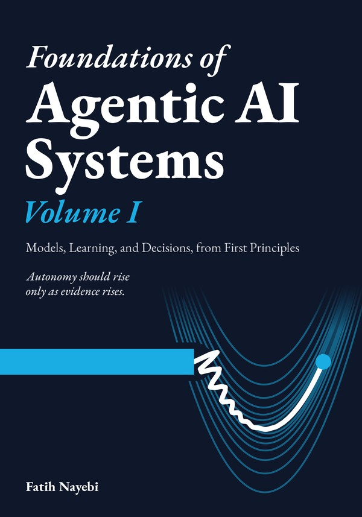
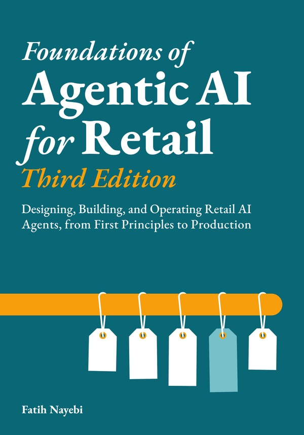

## Fatih Nayebi

I build agentic AI systems that make decisions in production, and I teach graduate students how to build them.

Founder and CEO of [OODARIS AI](https://oodaris.ai) · Assistant Professor in Information Systems at [McGill University](https://www.mcgill.ca/desautels/dr-fatih-nayebi) · formerly VP of Data & AI at ALDO Group

[fatihnayebi.com](https://fatihnayebi.com) · [Amazon author page](https://www.amazon.com/author/fatihnayebi) · [Google Scholar](https://scholar.google.com/citations?user=s6lWpdEAAAAJ) · [LinkedIn](https://linkedin.com/in/thefatih)

### Books

<table>
<tr>
<td align="center" valign="top" width="33%">
 
<b>Foundations of Agentic AI Systems, Volume I</b> 
Models, Learning, and Decisions, from First Principles 
<a href="https://www.amazon.com/dp/1069422665">Amazon</a> · <a href="https://github.com/gradient-divergence/agentic-ai-systems">code</a>
</td>
<td align="center" valign="top" width="33%">
 
<b>Foundations of Agentic AI Systems, Volume II</b> 
Agents, Operations, and Governance, in Production 
<a href="https://www.amazon.com/dp/1069422681">Amazon</a> · <a href="https://github.com/gradient-divergence/agentic-ai-systems">code</a>
</td>
<td align="center" valign="top" width="33%">
 
<b>Foundations of Agentic AI for Retail</b> 
Third Edition: Designing, Building, and Operating Retail AI Agents, from First Principles to Production 
<a href="https://www.amazon.com/dp/1069422649">Amazon</a> · <a href="https://github.com/gradient-divergence/agentic-retail-foundations">code</a>
</td>
</tr>
</table>

The two Systems volumes follow one running example, a refund agent, from the day it only drafts decisions for a person to its launch gate. Each method arrives as something the agent must show before it may act, and the examples run in the companion repository whose stored outputs the books print.

Earlier: *Swift 3 Functional Programming* (Packt, 2016) and *Swift Functional Programming*, Second Edition (Packt, 2017), with code at [PacktPublishing](https://github.com/PacktPublishing/Swift-Functional-Programming).

### Teaching

At McGill since 2019, five graduate courses: Enterprise Data Science, Machine Learning in Production, Introduction to AI and Deep Learning, Applications and Architectures of Deep Learning, and Designing and Building Agentic AI Systems. Student projects from these courses are in [mcgill-showcases](https://github.com/conqueror/mcgill-showcases).
